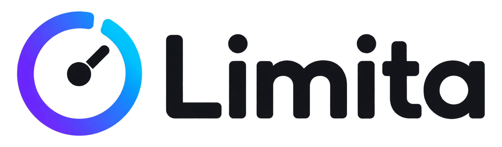
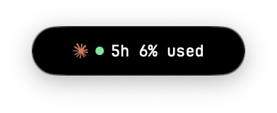
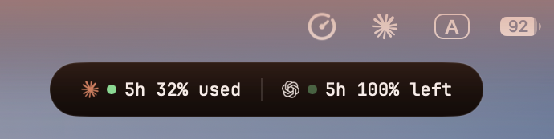
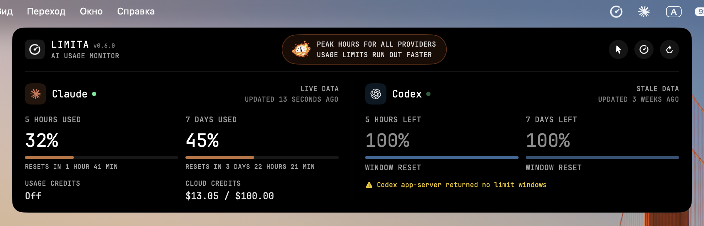
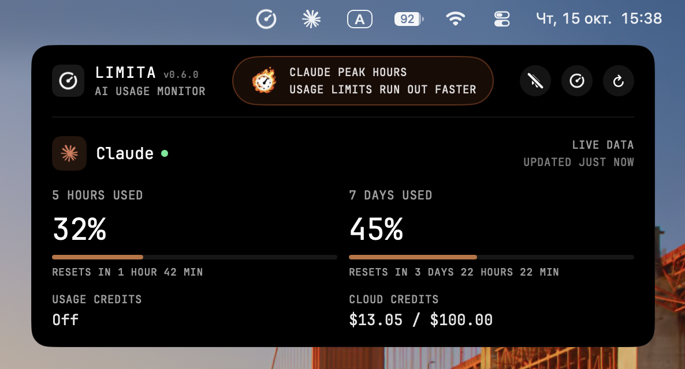

<p align="center">
  <picture>
    <source media="(prefers-color-scheme: dark)" srcset="docs/banner-dark.png">
    
  </picture>
</p>

<p align="center">
  <b>Claude Code and Codex rate limits, one glance from the top of your Mac — or from the Windows tray.</b>
</p>

<p align="center">
  <a href="https://limita.up.railway.app">Website</a> · <a href="https://limita.up.railway.app/ru/">На русском</a>
</p>

<p align="center">
  
  
  
  
  
</p>

---

Limita is a tiny native menu-bar app that shows how much of your **Claude** and **Codex** 5-hour and weekly limits you have, without opening a terminal.

## Features

- **Hover pill.** Rest the cursor at the top edge of any screen and a compact pill slides in with each service's 5-hour limit. Click it for the full dashboard.
- **Stays away from the notch.** The camera housing plus 80 pt on each side is left to other apps: nothing triggers or draws there.
- **Menu bar.** Left-click the icon for the dashboard, right-click for the menu. Clicking elsewhere closes it. The button next to **↻** in the dashboard hides or shows the icon until Limita quits; the icon is back on every launch.
- **Keyboard shortcut.** **⌃⌥L** (**Ctrl+Alt+L** on Windows) opens the dashboard at the top of the screen from any app, a terminal included; press it again to close it.
- **Floating window.** **⌃⌥P** (**Ctrl+Alt+P** on Windows), the pin button in the dashboard or **Floating Window** in the menu pins the dashboard as a window that stays on top, on every desktop, until you close it with ⌃⌥L, the menu-bar or tray icon, or the pin button. Drag it anywhere; it opens there again, also after a restart. It never takes keyboard focus from the app you type in.
- **iTerm2 status bar.** An optional plugin shows your 5-hour and weekly limits in iTerm2's status bar while Claude Code or Codex runs in the tab, and a click on them opens the dashboard. See [iTerm2](#iterm2).
- **Only what you use.** Connect or disconnect Claude Code and Codex from the menu; disconnected services are neither shown nor queried. On first launch Limita connects whatever it finds installed.
- **Live numbers.** Claude is queried every 3 minutes, Codex every 5 minutes, and both on **Refresh**; local sources are re-read every minute. If Claude answers "too many requests", Limita leaves it alone for 5 minutes, doubling up to half an hour (or longer if Claude asks), and says when it will try again.
- **One row per limit.** Each limit is a row: its name on top, then the percentage, as tall as the bar and the reset countdown that follow it. On plans with a separate weekly limit for one model (Fable on Claude Max), that limit gets its own row. Its share of the weekly limit shows twice: as the first, lighter part of the **7 DAYS** bar, and right of its own bar, e.g. **12% OF WEEKLY · MAX 50%**, as in Claude's settings.
- **Fold what you don't need.** On macOS the per-model limits (Fable) and the Claude credits have a **⌄** next to their name that folds them into a small capsule, e.g. **FABLE ⌃**, on the line of the **ACTIVITY** button; click the capsule to bring the row back. Folded rows stay folded across launches.
- **Your plan.** Each column is titled with your plan, e.g. "Claude Ultra" or "Codex Pro 200". A plan without a 5-hour limit, such as a verified Ultra or any Codex Pro, gets a purple ∞ meter instead of the percentage.
- **Balances.** Codex limit resets and credits (credits and USD, $1 = 25 credits). Claude usage credits and cloud session credits are rows like the limits, as in Claude's settings: the percentage and the bar show what is spent, and the dollars right of the bar what is left (e.g. "$163 OF $250 LEFT"). Cloud credits are a grant that ends, so their row says when they expire, or when it will disappear once all are spent, and goes away on that date. A balance a service does not report is hidden, and so are usage credits that are turned off.
- **Readable at a glance.** Claude shows what is **used**, Codex what is **left**, and the dashboard labels which is which. Each service's dot follows its 5-hour limit: green, yellow from 70 % used (30 % left), red from 90 %; stale data keeps its colour, dimmed. Percentages stay plain white, and the dashboard counts down to each reset to the minute. If a live update fails, the reason is shown right in the dashboard.
- **Activity.** **ACTIVITY** at the bottom right of the dashboard drops down a graph of tokens per day for each connected service, under its column; on macOS the button stays in place and the graph opens below it. **WEEK** shows the last 7 days, **MONTH** the last 5 weeks as a calendar, **ALL** everything saved up to half a year; weeks start on Monday. Above the graph: total tokens, favorite model (e.g. "Opus 5.5", "Sol 6"), messages, peak hour, and the tokens split into input, output, cache writes and cache reads. Hover a day (or click it) to see its date and a chip with its tokens in thousands. Each request is counted once, even when resumed sessions copy it into several transcripts, so totals can be lower than Claude Code's `/stats`. Claude Code deletes transcripts after 30 days by default, so Limita keeps the daily totals it has seen in `activity.json`.
- **Prime time.** During a service's peak hours, when usage limits run out faster, the dashboard header shows a burning-gauge badge: "CLAUDE PEAK HOURS" with one service connected, the name in bold when only one of two connected services is in peak hours, "PEAK HOURS FOR ALL PROVIDERS" when both are. With two columns the badge sits right after the title; with one it is centered. Claude: weekdays 5–11 AM Pacific time; Codex: weekdays 12:00–18:00 UTC. Both are shown in your local time.
- **Limit resets.** Each column says when the service last reset limits for everyone, e.g. **RESET FOR EVERYONE · 5 HOURS AGO**, or **BANKED RESET · USE BY OCT 22** for a reset you apply yourself; click the line for the announcement. Limita also notices when your own weekly limit starts over early, and when Codex gives you a new limit reset to redeem. New resets come as a system notification; on macOS, click it for the dashboard. **Reset Notifications** in the menu (the tray menu on Windows) turns them off. A line stays for 48 hours, a banked reset for as long as it can be applied. The first launch only records what is there, so an old reset is never announced. Global resets come from [codex-reset.com](https://codex-reset.com) and [claude-resets.com](https://claude-resets.com), credited under each line; see [Data sources](#data-sources).
- **Opens where you can see it.** Starting Limita from Launchpad, Finder or the Start menu, or opening it again while it runs, shows the dashboard right away. Started at login, it waits in the menu bar or tray.
- **Updates in one click.** When a new version is out, a green **⤓** button appears in the dashboard header next to the others; the first time you see it, it spells out the new version for a few seconds. Click it and Limita downloads the update, checks its signature, installs it and reopens. See [Updates](#updates).
- Multiple displays and full-screen Spaces. JetBrains Mono everywhere.

## Screenshots

This is how Limita looks on your Mac.

<!-- Window screenshots (⌘⇧4, Space) with the system shadow, taken at 2x. The pills sit
     on one line with no whitespace between them, their shadows keep them apart, and
     314 + 506 = 820. Both dashboards are at the same scale: 820 px for two columns,
     429 px for one. -->
<p align="center">
  
</p>

<p align="center">
  
</p>

<p align="center">
  
</p>

## Install

1. Download `Limita-<version>.dmg` from [Releases](../../releases). Take the latest release; anything from 0.13.0 on updates itself from then on, while older versions can't and are not worth installing.
2. Open it and drag **Limita** into **Applications**.
3. The build is not notarized yet, so macOS blocks the first launch. On macOS 14, right-click **Limita** in Applications → **Open** → **Open**. On macOS 15 or later, open Limita once, close the warning, then click **System Settings → Privacy & Security → Open Anyway** and confirm with your password. If that doesn't work, see [If macOS won't open Limita](#if-macos-wont-open-limita).

Limita lives in the menu bar only; it has no Dock icon.

On the first Claude refresh, macOS asks whether Limita may read `Claude Code-credentials` from the Keychain. Choose **Always Allow**.

### If macOS won't open Limita

If there is no **Open Anyway** button, or macOS says Limita "is damaged and can't be opened", remove the download quarantine from Limita alone and open it again:

```bash
xattr -dr com.apple.quarantine /Applications/Limita.app
```

This only touches Limita; every other app is still checked as before. Updates installed with the **⤓** button need nothing of the kind.

As a last resort, you can turn off Gatekeeper, the check that blocks the app, for the whole Mac. This is not recommended: while it is off, macOS no longer checks any app you open.

1. Run `sudo spctl --master-disable`.
2. On macOS 15 or later this only unlocks a setting: open **System Settings → Privacy & Security** and set **Allow applications from** to **Anywhere**.
3. Open Limita once.
4. Turn the check back on with `sudo spctl --master-enable`. Limita should keep opening; if macOS blocks it again, use the `xattr` command above.

## Updates

Limita checks GitHub Releases at launch and every 3 hours. While a newer version is out, a green **⤓** button shows in the dashboard header. The first time the dashboard shows it after launch, the button spells out the new version for 8 seconds ("LIMITA 0.15.0 IS OUT · CLICK TO UPDATE") and then folds back; nothing else changes until you click it.

Updates are installed only after their signature checks out:

- **macOS.** Each release's DMG is signed with an Ed25519 key that only the maintainer holds, and the signature is published next to it as `Limita-<version>.dmg.sig`. Limita downloads both, checks the signature against the public key built into the app, and checks that the DMG holds Limita itself (bundle id and version) before touching anything. Only then is the old copy in Applications set aside, the new one copied in and opened. If copying fails, the old copy is put back. A tampered or unsigned download is refused and the installed copy stays as it is.
- **Windows.** The installer is signed for [Tauri's updater](https://v2.tauri.app/plugin/updater/), and `latest.json` on the release carries its signature. The app checks it against the public key built into the app before running the installer, which then reopens Limita.

The private keys are not in this repository. Updates come only from this repository's releases, over HTTPS.

If Limita runs from a folder it cannot write to (or straight from the DMG), the button opens the release page instead. The first version with the button is 0.13.0: from an older version, install the latest release by hand once. On macOS, every new build asks again for access to `Claude Code-credentials` in the Keychain, as a manual reinstall does; choose **Always Allow**.

## iTerm2

The plugin adds a **Limita** component to iTerm2's status bar:

```text
🟢 Claude 5h 52% · 7d 49% used  │  🟢 Codex 5h 80% · 7d 64% left
```

It appears only in tabs where Claude Code or Codex is running and lists every service
you have connected in Limita. In other tabs the plugin hides the whole status bar, so it
takes no room. When the bar is short of room only the 5-hour limits are shown. A click
opens the Limita dashboard. The plugin reads what the running app shows, so Limita must
be running; without it the component says `Limita: not running`.

1. Download `limita.py` from [Releases](../../releases).
2. In iTerm2, open **Settings → General → Magic** and turn on **Enable Python API**.
3. Put the plugin into iTerm2's AutoLaunch folder, so it starts with iTerm2:

   ```bash
   mkdir -p ~/Library/Application\ Support/iTerm2/Scripts/AutoLaunch
   mv ~/Downloads/limita.py ~/Library/Application\ Support/iTerm2/Scripts/AutoLaunch/
   ```

4. Start it once from the menu bar: **Scripts → AutoLaunch → limita.py** (restart iTerm2 if
   AutoLaunch is not there yet). The first run asks to download iTerm2's Python runtime;
   allow it.
5. **Settings → Profiles → Session**: turn on **Status bar enabled** and click
   **Configure Status Bar**. Drag **Limita** from the component menu down into
   **Active Components** and click **OK**.

To make it look like the rest of the terminal, open **Configure Status Bar → Advanced…**:

- **Font**: choose the font of your profile (**Profiles → Text**).
- **Centred**: choose the **Tight packing** layout, then put a **Spring** on each side of
  Limita.
To keep the status bar and the limits in every tab, select Limita in **Configure Status
Bar**, click **Configure Component** and turn off **Only while Claude Code or Codex runs**.
The plugin hides the bar only in profiles whose bar holds Limita; the profile itself is
left as it is. Other components in that bar hide with it.

With a script in AutoLaunch, iTerm2 stops opening a window at startup. To keep that window,
turn on **Settings → General → Startup → Always open at least one terminal window at
startup**.

## Keeping Claude up to date

Claude Code's login token is **short-lived**, and only Claude Code itself renews it, while it is running. Limita reads that token but never renews it, because renewing it from outside could sign Claude Code out.

So after a long break from Claude Code, typically several hours, Claude's numbers stop updating:

- the dashboard shows **"Claude Code login expired … — open Claude Code to renew it"**;
- the last known numbers stay visible, dimmed and marked **STALE DATA**.

**To fix it, start Claude Code** (run `claude` in a terminal, or open it in your editor), then press **↻** in Limita or wait for the next refresh. Live data comes back as soon as Claude Code has renewed the login. Codex is not affected.

A long-lived token from `claude setup-token` does not help here: it only allows model requests, not reading usage limits.

## Wrong system clock

Limita compares each reset time with your computer's clock. A window whose reset time has passed is treated as reset, so it shows **0 %** and **"window reset"** until fresh numbers arrive.

If the clock runs ahead, a 5-hour window that is still open looks reset: the 5-hour limit seems to vanish while the weekly limit, whose reset is days away, still shows normally. This can happen after reinstalling or downgrading macOS, when the date and time are no longer set automatically.

**To fix it,** turn on **System Settings → General → Date & Time → Set time and date automatically** and check the time zone (on Windows: **Settings → Time & language → Date & time → Set time automatically**), then press **↻** in Limita.

## Data sources

| | Claude | Codex |
|---|---|---|
| **Live** | `GET api.anthropic.com/api/oauth/usage` with Claude Code's OAuth token | `codex app-server` → `account/rateLimits/read` (official; auth stays in the CLI) |
| **Fallback** | Claude Code status line, set up when you connect Claude Code | Latest `rate_limits` in `~/.codex/sessions/**/rollout-*.jsonl` |
| **Extras** | Usage credits, cloud session credits; plan from `GET api.anthropic.com/api/oauth/profile` | Limit resets, credit balance |
| **Resets for everyone** | `GET claude-resets.com/api/resets` | `GET codex-reset.com/api/forecast` |

**Reset trackers.** Resets that a service gives everyone are taken from two independent trackers, not from Anthropic or OpenAI: [claude-resets.com](https://claude-resets.com) (data under [CC BY 4.0](https://creativecommons.org/licenses/by/4.0/)) and [codex-reset.com](https://codex-reset.com). Thanks to both. Each line in the dashboard credits its tracker. Limita asks the tracker of each connected service at launch and every 15 minutes, with a `User-Agent` that names Limita, and backs off when a tracker asks it to. A reset Claude's tracker has not confirmed yet is shown but not announced.

**Claude usage API.** The endpoint is undocumented, the same one Claude Code's `/usage` uses, and it may change without notice. Limita reads the token from Claude Code's Keychain item `Claude Code-credentials`; macOS asks once. The token is only sent to `api.anthropic.com`. Limita never stores or refreshes it; see [Keeping Claude up to date](#keeping-claude-up-to-date).

**Claude status line.** **Connect Claude Code** in the menu adds Limita to `statusLine` in `~/.claude/settings.json`:

- An existing status line is wrapped, not replaced. Limita saves the limits and runs your command with the same input, so its output is unchanged.
- **Disconnect Claude Code** restores it. A backup is kept as `settings.json.limita-backup`.
- Connect from `/Applications`: a build-folder path disappears after a clean build.

## Privacy

- No accounts, cookies or passwords, and no analytics.
- Besides Anthropic, OpenAI and GitHub (for updates), Limita talks to `claude-resets.com` and `codex-reset.com` for the reset trackers, only for connected services. These requests carry nothing about you or your usage.
- Only rate-limit numbers and balances are read. Prompts, transcripts, project paths and session IDs are ignored.
- The Claude status-line cache (`~/Library/Application Support/Limita/claude-status.json`) holds only the two windows and a timestamp.
- For the iTerm2 plugin, the app writes what the dashboard shows to `~/Library/Application Support/Limita/snapshot.json`: percentages, reset times and status, nothing else. The file is removed when Limita quits.

## Build from source

The macOS app lives in `macos/`; the Windows app in [`windows/`](windows/README.md).
Requires macOS 14+, Xcode 15+ and [XcodeGen](https://github.com/yonaskolb/XcodeGen).

```bash
cd macos
swift test
xcodegen generate
xcodebuild -project Limita.xcodeproj -scheme Limita -configuration Release build
```

`macos/Limita.xcodeproj` is generated from `macos/project.yml`. Run `xcodegen generate` after adding or removing files.

`macos/scripts/make-dmg.sh` builds a Release copy and packages it as `macos/build/Limita-<version>.dmg` with the drag-to-install window, and signs it for the updater with `macos/scripts/sign-update.sh` (the key is read from `~/.limita-signing/macos-ed25519.key` or `LIMITA_SIGNING_KEY`). To try an update locally, serve a release JSON shaped like GitHub's and start Limita with `LIMITA_UPDATE_FEED=<its URL>`; `LIMITA_UPDATE_INSTALL=1` installs it without a click. Its background is rendered from `assets/design/dmg-background-source.webp` by `macos/scripts/dmg-background.py` (needs Pillow); rerun that after changing the layout. The prime-time badge animation, `prime-time.webp` for both apps, is built from `assets/design/prime-time-source.webm` by `scripts/prime-time-sprite.sh` (needs ffmpeg and cwebp). Artwork both apps use (that animation, the status glyph, the service logos) lives once in `assets/shared/`; `scripts/sync-assets.sh` copies it to the asset catalog and the Windows folders, and `--check` verifies the copies.

Live-update failures are logged: `log show --predicate 'subsystem == "com.limita.app"' --last 1h`.

```text
macos/
├── Limita/
│   ├── App/        lifecycle, status item, CLI entry for the status-line hook
│   ├── Data/       readers, live clients, Claude status-line setup
│   ├── Models/     limit windows, service state, balances
│   ├── UI/         panel controller, pill, dashboard, layout, font
│   └── Resources/  app icon, menu-bar icon, bundled font
├── Tests/LimitaTests/
├── integrations/   the iTerm2 status-bar plugin
├── scripts/        DMG packaging and update signing
└── dmg/            DMG background
windows/            the Windows app (Tauri + Rust)
assets/             artwork shared by both apps (shared/) and its sources (design/)
scripts/            asset sync, prime-time sprite
docs/               banners and screenshots
```

## Windows

Limita also runs on Windows 10 and 11: a tray icon with the traffic-light dot, the same
dashboard next to it, and the hover pill in the middle of the top edge of any screen. The
pill stays out of the corners, where menus and window buttons are, and never appears over
full-screen apps and games, borderless ones included. Both apps share one version and one
release.

1. Download `Limita_<version>_x64-setup.exe` from the latest of the [Releases](../../releases); as on macOS, 0.13.0 and later update themselves.
2. Run it; it installs for your user, no administrator rights needed. The installer is not
   signed yet: on the SmartScreen warning choose **More info → Run anyway**.

The Windows app is built with Tauri and Rust in [`windows/`](windows/README.md), which
covers the differences from macOS, troubleshooting and building from source.

## License

MIT, see [LICENSE](LICENSE). The bundled JetBrains Mono Nerd Font is under the SIL Open Font License 1.1, see [THIRD_PARTY_NOTICES.md](THIRD_PARTY_NOTICES.md).

Limita is not affiliated with OpenAI or Anthropic.
